# Graffard Racing — Data model V0

This is the conceptual data model (MCD) proposed in **"GRAFFARD RACING – Processus et MCD V0"** (slides 12–37), translated into English for reference. It is a **working basis, not a validated model**: the client has not ratified the schema or the number of tables.

| | |
|---|---|
| Tables | **49** |
| Fields | **287** (primary keys included) |
| Foreign keys | **80** |
| Domains | 9 |
| SQL version | [`graffard_racing_mcd_v0.sql`](graffard_racing_mcd_v0.sql), PostgreSQL (tested on 17) |

How to read the notation (same as in the source documents):

- `field?` is an **optional** foreign key (nullable).
- `field!` is a **one-to-one** foreign key (unique).
- Table and field names stay in French, as in the documents. A short English gloss is given for each table.

The MCD lists field names only. The data types in the SQL file are indicative choices; you are free to change them.

> **Important vocabulary.** A **cour** (yard) is a place (`LIEU`). A **course** (race) is a competition (`COURSE`). A **lot** is a training rotation, not a place. An **acteur** (actor) is any person or organisation; its business role (`roles_metier`) is distinct from its application role (`ROLE`).

---

## Domain overview

| # | Domain | Tables | Count |
|---|---|---|---|
| 1 | Reference data | CHEVAL, ACTEUR, ECURIE | 3 |
| 2 | Horse population & location | LIEU, SEJOUR, MOUVEMENT, DETENTION | 4 |
| 3 | Health & compliance | PRODUIT, ACTE_SANTE, PRESCRIPTION, EXAMEN, VACCINATION, ADMINISTRATION, ACTE_PRESCRIPTION, ACTE_DOCUMENT | 8 |
| 4 | Field work & feeding | LOT, SEANCE, AFFECTATION, RATION | 4 |
| 5 | Races & travel | COURSE, ENGAGEMENT, RESULTAT, TRANSPORT, PRISE_EN_CHARGE, ENGAGEMENT_TRANSPORT | 6 |
| 6 | Human resources | EMPLOYE, CRENEAU, EMPLOYE_CRENEAU, POINTAGE, ABSENCE | 5 |
| 7 | History & communication | EVENEMENT, DOCUMENT, EVENEMENT_DOCUMENT, NOTIFICATION, RECEPTION | 5 |
| 8 | Billing *(proposed extension, scope to arbitrate)* | FACTURE, LIGNE_FACTURE, PRESTATION, IMPUTATION, REGLEMENT, AFFECTATION_PAIEMENT | 6 |
| 9 | Access, interfaces & assistance *(technical model, to frame)* | COMPTE, ROLE, HABILITATION, PERMISSION, ROLE_PERMISSION, ECHANGE, REQUETE_IA, ARTICLE_AIDE | 8 |

Every table has an `id` primary key.

---

## 1. Reference data

| Table | Meaning | Foreign keys | Other fields |
|---|---|---|---|
| **CHEVAL** | Horse. One record per horse followed by the stable: identity, SIRE number, status. | — | sire, nom, sexe, date_naissance, statut |
| **ACTEUR** | Actor. A person or organisation linked to the stable: trainer, assistant trainer, yard manager, rider/groom, vet, dentist, farrier, owner, jockey, transporter, admin/HR, entries officer. Internal and external contributors are all actors. One record may hold several roles without being an employee or having an account. | — | nom, type_acteur, roles_metier, email, telephone, adresse |
| **ECURIE** | Stable. An operating structure managed in the application. It owns places, invoices and the scope of access rights. | — | nom, adresse, statut |

## 2. Horse population & location

| Table | Meaning | Foreign keys | Other fields |
|---|---|---|---|
| **LIEU** | Place. A physical space: site, yard, building or box. Belongs to a stable and may sit inside another place. | ecurie_id → ECURIE, lieu_parent_id? → LIEU | libelle, type_lieu, capacite |
| **SEJOUR** | Stay. A period during which a horse is in a place, with start/end dates and reason. | cheval_id → CHEVAL, lieu_id → LIEU | date_debut, date_fin, motif |
| **MOUVEMENT** | Movement. An arrival, departure or transfer of a horse: places, date, transporter, delivery note reference. | cheval_id → CHEVAL, lieu_depart_id? → LIEU, lieu_arrivee_id? → LIEU, transporteur_id? → ACTEUR | date_heure, sens, provenance_texte, destination_texte, reference_bon |
| **DETENTION** | Ownership. Links a horse to an owner, with validity period and share for co-ownership. | cheval_id → CHEVAL, proprietaire_id → ACTEUR | date_debut, date_fin, quote_part |

## 3. Health & compliance

| Table | Meaning | Foreign keys | Other fields |
|---|---|---|---|
| **PRODUIT** | Product. A medicine, vaccine or other health product. | — | nom, categorie, unite |
| **ACTE_SANTE** | Health act. A care act, examination, vaccination or **farriery** act, with the person who performed it and the sanitary follow-up (withdrawal period, certification). | cheval_id → CHEVAL, intervenant_id → ACTEUR, certificateur_id? → ACTEUR | date_heure, type_acte, soin, delai_retrait_jours, debut_retrait, fin_retrait, statut_certification, date_certification, type_ferrure, observations |
| **PRESCRIPTION** | Prescription. A product prescribed for a horse, with dosage, duration and the prescription document. | cheval_id → CHEVAL, prescripteur_id → ACTEUR, produit_id → PRODUIT, ordonnance_id? → DOCUMENT | date_prescription, posologie, duree_jours |
| **EXAMEN** | Examination. Clinical details of an act: limb, lameness score, sensitivity, recommended protocol. | acte_id! → ACTE_SANTE | membre, score_boiterie, sensibilite, protocole_recommande |
| **VACCINATION** | Vaccination. The vaccine used for an act and the next booster date. | acte_id! → ACTE_SANTE, vaccin_id → PRODUIT | date_prochain_rappel |
| **ADMINISTRATION** | Administration. An actual intake of a product: date, dose and route, during an act. | acte_id → ACTE_SANTE, produit_id → PRODUIT | date_heure, dose, unite, voie |
| **ACTE_PRESCRIPTION** | Link between an act performed and the prescription it follows. | acte_id → ACTE_SANTE, prescription_id → PRESCRIPTION | — |
| **ACTE_DOCUMENT** | Link between an act and a supporting document: certificate, photo, report. | acte_id → ACTE_SANTE, document_id → DOCUMENT | — |

## 4. Field work & feeding

| Table | Meaning | Foreign keys | Other fields |
|---|---|---|---|
| **LOT** | Lot. A morning training rotation. The assistant trainer assigns horses and riders to it, then shares the programme with the yards. | lieu_id → LIEU, responsable_id → ACTEUR | date, heure ⚠️, libelle |
| **SEANCE** | Session. The work of one horse in a lot: exercise, planned work, work actually done, comment. | cheval_id → CHEVAL, lot_id → LOT | exercice, travail_prevu, travail_realise, commentaire |
| **AFFECTATION** | Assignment. An actor assigned to a session, with function and instructions (e.g. the rider in charge of a horse). | seance_id → SEANCE, acteur_id → ACTEUR | date_heure, fonction, consigne |
| **RATION** | Ration. A meal observation for a horse: which meal, share eaten, remark, date and author. | cheval_id → CHEVAL, auteur_id → ACTEUR | date_heure, repas, part_consommee, remarque |

## 5. Races & travel

| Table | Meaning | Foreign keys | Other fields |
|---|---|---|---|
| **COURSE** | Race. A horse-racing competition identified by edition, date and racecourse. | — | date_heure, nom, edition, hippodrome, pays, distance |
| **ENGAGEMENT** | Race entry. A horse entered in a race, with status, cost, pre-race check and optional jockey. | cheval_id → CHEVAL, course_id → COURSE, jockey_id? → ACTEUR | date_engagement, statut, cout, resultat_controle, date_controle |
| **RESULTAT** | Result. The result of a race entry: rank, time, comment. At most one per entry. | engagement_id! → ENGAGEMENT | rang, temps, commentaire |
| **TRANSPORT** | Transport. A trip organised with a transporter: places, dates, instructions. May carry several horses. | transporteur_id → ACTEUR, lieu_depart_id? → LIEU, lieu_arrivee_id? → LIEU | date_depart, date_arrivee, statut, consignes |
| **PRISE_EN_CHARGE** | Pick-up. A horse's presence in a transport, with pick-up and drop-off places and times. | cheval_id → CHEVAL, transport_id → TRANSPORT, lieu_prise_id? → LIEU, lieu_depose_id? → LIEU | heure_prise_en_charge, heure_depose |
| **ENGAGEMENT_TRANSPORT** | Link between a race entry and a trip. | engagement_id → ENGAGEMENT, transport_id → TRANSPORT | — |

## 6. Human resources

| Table | Meaning | Foreign keys | Other fields |
|---|---|---|---|
| **EMPLOYE** | Employee. HR record of a salaried actor: staff number, position, contract, dates. External providers stay actors without this record. | acteur_id! → ACTEUR | matricule, poste, contrat, date_entree, date_sortie |
| **CRENEAU** | Time slot. A planned work slot, with activity and optional place. | lieu_id? → LIEU | debut, fin, activite |
| **EMPLOYE_CRENEAU** | Assignment of an employee to a slot. A slot can hold several employees. | employe_id → EMPLOYE, creneau_id → CRENEAU | — |
| **POINTAGE** | Time record. Actual presence of an employee: in/out times, duration, optional correction. | employe_id → EMPLOYE, correcteur_id? → ACTEUR | heure_entree, heure_sortie, duree, motif_correction |
| **ABSENCE** | Absence. A period of unavailability (leave or other), with type and validation workflow. | employe_id → EMPLOYE, validateur_id? → ACTEUR | debut, fin, type_absence, statut, date_validation |

## 7. History & communication

| Table | Meaning | Foreign keys | Other fields |
|---|---|---|---|
| **EVENEMENT** | Event. A dated entry in a horse's history, with author, text, source and validation status. | cheval_id → CHEVAL, auteur_id → ACTEUR | date_heure, type_evenement, texte, source, statut_validation |
| **DOCUMENT** | Document. Reference to a file: type, date, version, storage URI. | — | type_document, date_document, uri, version |
| **EVENEMENT_DOCUMENT** | Link between a history entry and an attached document (photo, report, audio…). | evenement_id → EVENEMENT, document_id → DOCUMENT | — |
| **NOTIFICATION** | Notification. A message or alert to broadcast, with subject and priority. May relate to an event. | evenement_id? → EVENEMENT | date_creation, objet, priorite |
| **RECEPTION** | Delivery. Tracking of a notification for one recipient: sent, read, status. | notification_id → NOTIFICATION, destinataire_id → ACTEUR | date_envoi, date_lecture, statut |

## 8. Billing *(proposed extension)*

Billing was not part of the mock-up presented to the client. Its scope and solution are still to be arbitrated.

| Table | Meaning | Foreign keys | Other fields |
|---|---|---|---|
| **FACTURE** | Invoice header, issued by a stable to a recipient actor. | ecurie_id → ECURIE, destinataire_id → ACTEUR | numero, date_emission, date_echeance, statut |
| **LIGNE_FACTURE** | Invoice line: label, quantity, unit price, tax rate. | facture_id → FACTURE | libelle, quantite, prix_unitaire, taux_taxe |
| **PRESTATION** | Service. A billable service for a horse, at a given date, with type, amount and optional proof. | cheval_id → CHEVAL, justificatif_id? → DOCUMENT | date, type_prestation, montant |
| **IMPUTATION** | Allocation of all or part of a service to an invoice line. | ligne_id → LIGNE_FACTURE, prestation_id → PRESTATION | quantite_imputee, montant_impute |
| **REGLEMENT** | Payment received: date, amount, method, reference. | — | date, montant, mode, reference |
| **AFFECTATION_PAIEMENT** | Share of a payment allocated to an invoice (partial or multi-invoice payments). | facture_id → FACTURE, reglement_id → REGLEMENT | montant_affecte |

## 9. Access, interfaces & assistance *(technical model)*

AI, OCR, synchronisation and integrations still need technical framing.

| Table | Meaning | Foreign keys | Other fields |
|---|---|---|---|
| **COMPTE** | Account. Application access for an actor. An actor may exist without an account. | acteur_id! → ACTEUR | login, etat |
| **ROLE** | Application role: a rights profile, distinct from the actor's business role. | — | libelle |
| **HABILITATION** | Authorisation. A role granted to an account for a given stable. | compte_id → COMPTE, role_id → ROLE, ecurie_id → ECURIE | — |
| **PERMISSION** | A right on a resource: read, create or update. | — | code, libelle, ressource, action |
| **ROLE_PERMISSION** | Link between a role and each of its rights. | role_id → ROLE, permission_id → PERMISSION | — |
| **ECHANGE** | Exchange. Trace of an import, export or exchange with an external system. | initiateur_id? → COMPTE | source, date_heure, sens, etat, anomalies, correspondances_identifiants |
| **REQUETE_IA** | AI request. A question to the AI assistant, with answer, context and author account. | compte_id → COMPTE | date_heure, question, reponse, contexte |
| **ARTICLE_AIDE** | Help article, with theme, version and author account. | auteur_id → COMPTE | titre, theme, contenu, version |

---

## Relationship diagram

All 80 foreign keys. Read `A ||--o{ B` as "one A, many B". Rendered natively by GitLab and GitHub (Mermaid).

```mermaid
erDiagram
    %% 2. Horse population & location
    ECURIE ||--o{ LIEU : "ecurie_id"
    LIEU |o--o{ LIEU : "lieu_parent_id"
    CHEVAL ||--o{ SEJOUR : "cheval_id"
    LIEU ||--o{ SEJOUR : "lieu_id"
    CHEVAL ||--o{ MOUVEMENT : "cheval_id"
    LIEU |o--o{ MOUVEMENT : "lieu_depart_id"
    LIEU |o--o{ MOUVEMENT : "lieu_arrivee_id"
    ACTEUR |o--o{ MOUVEMENT : "transporteur_id"
    CHEVAL ||--o{ DETENTION : "cheval_id"
    ACTEUR ||--o{ DETENTION : "proprietaire_id"

    %% 3. Health & compliance
    CHEVAL ||--o{ ACTE_SANTE : "cheval_id"
    ACTEUR ||--o{ ACTE_SANTE : "intervenant_id"
    ACTEUR |o--o{ ACTE_SANTE : "certificateur_id"
    CHEVAL ||--o{ PRESCRIPTION : "cheval_id"
    ACTEUR ||--o{ PRESCRIPTION : "prescripteur_id"
    PRODUIT ||--o{ PRESCRIPTION : "produit_id"
    DOCUMENT |o--o{ PRESCRIPTION : "ordonnance_id"
    ACTE_SANTE ||--o| EXAMEN : "acte_id"
    ACTE_SANTE ||--o| VACCINATION : "acte_id"
    PRODUIT ||--o{ VACCINATION : "vaccin_id"
    ACTE_SANTE ||--o{ ADMINISTRATION : "acte_id"
    PRODUIT ||--o{ ADMINISTRATION : "produit_id"
    ACTE_SANTE ||--o{ ACTE_PRESCRIPTION : "acte_id"
    PRESCRIPTION ||--o{ ACTE_PRESCRIPTION : "prescription_id"
    ACTE_SANTE ||--o{ ACTE_DOCUMENT : "acte_id"
    DOCUMENT ||--o{ ACTE_DOCUMENT : "document_id"

    %% 4. Field work & feeding
    LIEU ||--o{ LOT : "lieu_id"
    ACTEUR ||--o{ LOT : "responsable_id"
    CHEVAL ||--o{ SEANCE : "cheval_id"
    LOT ||--o{ SEANCE : "lot_id"
    SEANCE ||--o{ AFFECTATION : "seance_id"
    ACTEUR ||--o{ AFFECTATION : "acteur_id"
    CHEVAL ||--o{ RATION : "cheval_id"
    ACTEUR ||--o{ RATION : "auteur_id"

    %% 5. Races & travel
    CHEVAL ||--o{ ENGAGEMENT : "cheval_id"
    COURSE ||--o{ ENGAGEMENT : "course_id"
    ACTEUR |o--o{ ENGAGEMENT : "jockey_id"
    ENGAGEMENT ||--o| RESULTAT : "engagement_id"
    ACTEUR ||--o{ TRANSPORT : "transporteur_id"
    LIEU |o--o{ TRANSPORT : "lieu_depart_id"
    LIEU |o--o{ TRANSPORT : "lieu_arrivee_id"
    CHEVAL ||--o{ PRISE_EN_CHARGE : "cheval_id"
    TRANSPORT ||--o{ PRISE_EN_CHARGE : "transport_id"
    LIEU |o--o{ PRISE_EN_CHARGE : "lieu_prise_id"
    LIEU |o--o{ PRISE_EN_CHARGE : "lieu_depose_id"
    ENGAGEMENT ||--o{ ENGAGEMENT_TRANSPORT : "engagement_id"
    TRANSPORT ||--o{ ENGAGEMENT_TRANSPORT : "transport_id"

    %% 6. Human resources
    ACTEUR ||--o| EMPLOYE : "acteur_id"
    LIEU |o--o{ CRENEAU : "lieu_id"
    EMPLOYE ||--o{ EMPLOYE_CRENEAU : "employe_id"
    CRENEAU ||--o{ EMPLOYE_CRENEAU : "creneau_id"
    EMPLOYE ||--o{ POINTAGE : "employe_id"
    ACTEUR |o--o{ POINTAGE : "correcteur_id"
    EMPLOYE ||--o{ ABSENCE : "employe_id"
    ACTEUR |o--o{ ABSENCE : "validateur_id"

    %% 7. History & communication
    CHEVAL ||--o{ EVENEMENT : "cheval_id"
    ACTEUR ||--o{ EVENEMENT : "auteur_id"
    EVENEMENT ||--o{ EVENEMENT_DOCUMENT : "evenement_id"
    DOCUMENT ||--o{ EVENEMENT_DOCUMENT : "document_id"
    EVENEMENT |o--o{ NOTIFICATION : "evenement_id"
    NOTIFICATION ||--o{ RECEPTION : "notification_id"
    ACTEUR ||--o{ RECEPTION : "destinataire_id"

    %% 8. Billing
    ECURIE ||--o{ FACTURE : "ecurie_id"
    ACTEUR ||--o{ FACTURE : "destinataire_id"
    FACTURE ||--o{ LIGNE_FACTURE : "facture_id"
    CHEVAL ||--o{ PRESTATION : "cheval_id"
    DOCUMENT |o--o{ PRESTATION : "justificatif_id"
    LIGNE_FACTURE ||--o{ IMPUTATION : "ligne_id"
    PRESTATION ||--o{ IMPUTATION : "prestation_id"
    FACTURE ||--o{ AFFECTATION_PAIEMENT : "facture_id"
    REGLEMENT ||--o{ AFFECTATION_PAIEMENT : "reglement_id"

    %% 9. Access, interfaces & assistance
    ACTEUR ||--o| COMPTE : "acteur_id"
    COMPTE ||--o{ HABILITATION : "compte_id"
    ROLE ||--o{ HABILITATION : "role_id"
    ECURIE ||--o{ HABILITATION : "ecurie_id"
    ROLE ||--o{ ROLE_PERMISSION : "role_id"
    PERMISSION ||--o{ ROLE_PERMISSION : "permission_id"
    COMPTE |o--o{ ECHANGE : "initiateur_id"
    COMPTE ||--o{ REQUETE_IA : "compte_id"
    COMPTE ||--o{ ARTICLE_AIDE : "auteur_id"
```

---

## Known gaps between the MCD and the specification

The functional specification describes the **target**; the MCD is an earlier **draft**. Where they disagree, the specification prevails. These gaps are left untouched in the SQL file on purpose: **arbitrating and justifying them is part of the Level 2 challenge.**

| # | Gap | Where it shows | What the specification says |
|---|---|---|---|
| 1 | `LOT.heure` exists | LOT table | A lot is a rotation identified by its number, yard and date. It has **no start time, end time or time range**, on any screen, and no time is asked when a lot is created, edited, carried over or published (§7, §12). |
| 2 | No `RESTRICTION` table | Health domain | An active **or unknown** restriction blocks a race-entry validation locally and shows the justification (§12). A restriction references its source, scope and validator. An expired date never lifts it automatically (§7). The deck adds "block or alert before the race". |
| 3 | No `MESURE` table | Health domain | Quick measurements (temperature, weight) are captured by picking the horse and typing a number. |
| 4 | No special-diet table | Feeding domain | Special diets must be visible on the feeding checklist (today they are marked with an asterisk on the box board). |
| 5 | Planning versions not modelled | LOT / SEANCE | Lot publication is versioned; a draft never silently replaces the published version. |
| 6 | Sync, conflicts and audit not modelled | All domains | Offline entries show their state and never create duplicates; a conflict keeps both versions; every sensitive correction keeps before, after and reason. Every record carries a stable identifier, an author, a real date, a date of receipt, a source and a status. |

Other points worth checking against the specification (§8 lists the target cardinalities by domain): the planned-vs-actual distinction for prescriptions and administrations, farriery stored in `ACTE_SANTE`, and the fact that billing is an extension outside the core scope.

---

## Migration 0002 — arbitrated changes

`api/src/db/migrations/0002_schema_mission2.ts` applies, after `0001_mcd_v0` and in one transaction, the arbitrations of `docs/mission2/DECISIONS.md`. The SQL file above stays the untouched MCD V0. After both migrations `public` holds **54 tables** (49 + `restriction`, `mesure`, `regime_special`, `audit`, `commande_sync`). One line per arbitration:

| Arbitration | Change | Why |
|---|---|---|
| **D5** — gap 1 | `lot.heure` dropped; `lot.ordre_passage integer NOT NULL` (> 0) added; `lot.libelle` becomes `NOT NULL`; `UNIQUE (libelle, lieu_id, date)` | A lot has no time; it is identified by its number (`libelle`, the column that carries it in the MCD), its yard (`lieu_id`) and the programme date (`date`). `libelle` is made `NOT NULL` because a NULL would escape the uniqueness. **Hypothesis:** 0002 assumes `lot` is empty (no seed before it); on a base holding lots the `NOT NULL` additions fail and 0002 rolls back whole — remedy: delete `data/pglite` (git-ignored) and migrate again. |
| **D6** — gap 2 | Table `restriction`: `cheval_id`, `source` (`administration`, `examen`, `manuel`), `source_id`, `debut`, `fin_prevue`, `statut` (`active`, `levee`, default `active`), `validateur_id`, `leve_par_id`, `leve_le`, `motif_levee` | A lifted restriction must name who, when and a non-blank reason (CHECK `restriction_levee_tracee`); a non-manual restriction must reference its source (`restriction_source_referencee`). No trigger lifts a restriction when `fin_prevue` is past: lifting is always explicit. Triggers `restriction_sans_effacement` (row, BEFORE UPDATE OR DELETE) and `restriction_sans_truncate` (statement) refuse any DELETE or TRUNCATE, and freeze a lifted restriction: it can never be edited or reopened. An active one stays editable (e.g. `fin_prevue`). |
| **D6** — gap 3 | Table `mesure`: `cheval_id`, `type` (`temperature`, `poids`), `valeur`, `unite`, `auteur_id`, `date_reelle` | Quick measurements. |
| **D6** — gap 4 | Table `regime_special`: `cheval_id`, `description`, `debut`, `fin` (≥ `debut`), `valide_par_id` | Special diets visible on the feeding checklist. |
| **Q1** (pilot, 2026-10-29) | `produit.delai_retrait_jours integer`, nullable, ≥ 0 | NULL means **unknown period** (D10: "unknown status"). `acte_sante.delai_retrait_jours` stays the copy frozen when the act is recorded (versioned protocols, §7). |
| **D8** — gap 6 | Table `audit` (`objet`, `objet_id`, `avant` jsonb, `apres` jsonb, `motif` non-blank, `auteur_id`, `horodatage`); two triggers refuse every `UPDATE`, `DELETE` (row-level `audit_ajout_seul`) and `TRUNCATE` (statement-level `audit_sans_truncate`) on it | A correction keeps before, after and reason; no `UPDATE`, `DELETE` or `TRUNCATE` erases the trail. **Bound:** a superuser or the table owner can still drop the triggers; hardening the roles is deferred to the endpoints. |
| **D8** — gap 6 | Table `commande_sync` (`id_commande text UNIQUE`, `statut` `recue`/`appliquee`/`rejetee`, `accuse` jsonb, `erreur`, `recu_le`) | Idempotency key generated by the device: a replayed command hits the unique key instead of creating a duplicate. `statut` here is the processing state of the command, not a record status. `CONFLIT` is not created (offline is out of scope, H3). |
| **D8** — gap 6 | Common columns `auteur_id`, `date_reelle`, `date_reception` (default `now()`), `source`, `statut` on the H1 tables | `date_reelle` (what happened) is distinct from the planned `date_heure` of the MCD (planned ≠ actual). `ration.auteur_id` already existed (NOT NULL) and is kept as is. |
| **D9** | Type `statut_enregistrement` ENUM (`brouillon`, `valide`, `publie`, `realise`, `annule`, `corrige`), used by the `statut` common column (default `brouillon`) | One shared status. "En retard" (late) is **computed**, never stored. |
| **D9** — existing `text` status | `engagement.statut` (text) is **renamed** `statut_officiel` and kept, then doubled by the new `engagement.statut statut_enregistrement` | Choice "left in place and doubled": the MCD column holds the official status (France Galop), whose values are not the enum's; a `USING` cast would have lost or guessed them. The local record status never replaces the official one (§7). |
| **H1** — hypothesis (D8 scope) | The common columns are added to the **scope-A tables only**: `ration`, `acte_sante`, `administration`, `engagement`, and the new `restriction`, `mesure`, `regime_special` | The other MCD tables are outside the D2-A scope and stay as in V0. On `restriction`, `source` and `statut` keep their D6 meaning (cause of the restriction; `active`/`levee`), so it receives only `auteur_id`, `date_reelle` and `date_reception`. |

Out of scope of 0002: `PROGRAMME` (D7, only with D2-C), `CONFLIT` (D8, offline only), any route or demo data.
